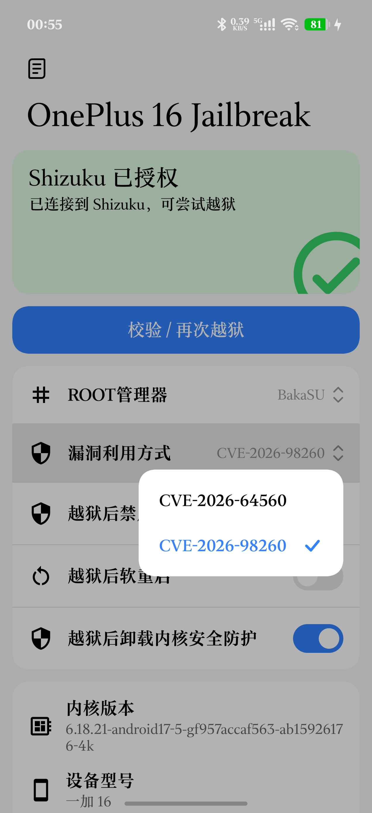
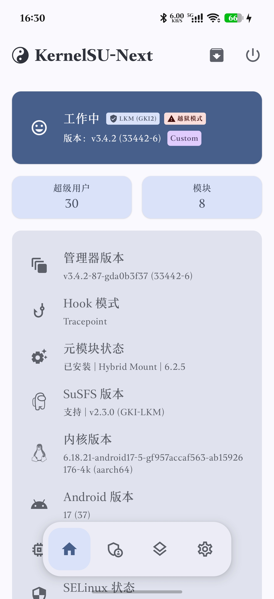

# Shark

OnePlus 16（PYB110）一键越狱工具。

在 **OnePlus 16（PYB110，SM8950，Android 17 / ColorOS，内核 `6.18.21-android17-5-gf957accaf563-ab15926176-4k`）** 上，通过 **CVE-2026-98260-6.18** / **CVE-2026-98260-6.12** 提权，并加载 **内核态 root（KernelSU / FinaSU / KernelSU Next / BakaSU / SukiSU Ultra）** 的一键工具与源码。

设备未解锁 BL，起手只有 adb shell（uid 2000）。工具通过 Shizuku 以 shell 身份驱动设备端 exploit，最终加载按本机 GKI 6.18.21 自编的 LKM：6.18 与 6.12 两条 98260 分支都走 `ksud late-load`，不再内置 KernelSU LKM、不再使用 `insmod` 回退。

> 仅用于自有设备的系统研究。存在竞态与重启风险，详见「风险」一节。

## 当前状态

- **两个分支可选**：默认 `CVE-2026-98260-6.18`，使用单入口 Rust 工具 `t98260`（内嵌现有 C plant：exec + POSIX 定时器 UAF、假 cred 指针写；cred 子进程一次性 late-load，无 rootd）；`CVE-2026-98260-6.12` 保持 `run612.sh + t61269`。两条都只走 `ksud late-load`。
- **KernelSU（官方 main，UAPI6）**：LKM 按 `main` `db6263d3`（`v3.3.1-27-gdb6263d3`，versionCode 32707）用本机 6.18.21 GKI 重编，382,232 B、229 个 UNDEF 全部能由 `syms.txt` 解析，真机验证通过；ksud 同版本（6,618,008 B，uapi 6）。管理器需用同版本的 `KernelSU_v3.3.1-27-gdb6263d3_32707-release.apk`（与旧版 32680 同签名，`adb install -r` 直接覆盖）；旧管理器的 supercall 仍可用，但没有 UAPI6 的模块 preinit 等新特性。注意 UAPI6 的 ksud 必须配 UAPI6 LKM（ksud 启动会校验），不能与旧 5 版 LKM 混用。
- **BakaSU（原 ReSukiSU）**：LKM/ksud/管理器对齐上游 `35253`（`v4.2.0-rc3` 之后 `5785bdb8`，`4.2.0-rc3-82`，uapi 6），LKM 435,616 B；管理器与 35252 同签名可直接 `adb install -r` 覆盖（35252 已真机验证，35253 为版本同步）。
- **FinaSU（v1.3.2 最新）**：按 `master` `9b32bde4` 重编 LKM 496,744 B（UNDEF 232 全命中）、ksud 7,561,328 B（uapi 6），管理器 v1.3.2（33090）；使用 `KSU_DYNAMIC_MANAGER` 动态签名（`ksud dynamic set-apk`）。
- **KernelSU Next（dev 最新）**：按 `dev` `da0b3f37`（`v3.4.2-87-gda0b3f37`，管理器 versionCode 33442）重编 LKM 489,264 B、ksud 7,611,344 B（uapi 6）；管理器由用户安装，App 中可选，真机验证通过（33442-6）。
- **SukiSU Ultra（v4.3.0 最新）**：按 tag `v4.3.0`（HEAD `e67b14e6`）重编 LKM 545,040 B、ksud 7,858,624 B（uapi 6），管理器 41100；41068 与 4.3.0（41100-6）均真机验证通过。
- **CVE-2026-98260-6.12（新分支，实验）**：接入按本仓库提速方法改造的 `YuKongA/CVE-2026-98260`（目标 6.12.69 / PLZ110）。按 98260 的逻辑重排为 **plant → rootd → ksud late-load → install → 管理器**：`t61269` 只负责 UAF 与 rootd，`t61269_su` 是 rootd 客户端，`run612.sh` 负责校验内核、调 ksud、安装与收尾；部署不带 ko/syms，ksud 运行时从已安装管理器 APK 的 `lib/arm64` 原地执行（SukiSU 为随机名，按大小 + `--version` 识别），不再拷贝、不再内置。已在 PLZ110（6.12.69）用 SukiSU 41100 真机跑通，连续复测命中率正常。
- App 为单页设置：ROOT 管理器与漏洞利用方式各一个下拉，另有四个流程开关；release 签名 APK v1.57 已构建（6,653,378 B，md5 `4ff84cbdd1f48d0a0a1eaec0fe092ec3`）。
- **内置范围**：APK 只内置 6.18 单入口 `t98260`、6.12 的 `t61269/t61269_su/run612.sh` 和两个 SUSFS ko（`assets/pyb110` 约 9 MB，release APK 约 6.6 MB）；**不再内置 ksud**，运行时从已安装管理器 APK 的 `lib/arm64` 原地执行，因此**必须先安装所选管理器**。

## 截图

<table align="center">
  <tr>
    <td align="center"><br><sub><b>1 · App 设置页</b></sub></td>
    <td align="center"><br><sub><b>2 · 漏洞利用方式</b></sub></td>
    <td align="center"><br><sub><b>3 · ROOT 管理器</b></sub></td>
  </tr>
  <tr>
    <td align="center"><br><sub><b>4 · KernelSU 管理器</b></sub></td>
    <td align="center"><br><sub><b>5 · KernelSU-Next 管理器</b></sub></td>
    <td align="center"><br><sub><b>6 · BakaSU 管理器</b></sub></td>
    <td align="center"><br><sub><b>7 · SukiSU Ultra 管理器</b></sub></td>
  </tr>
</table>

## 工作原理

```
┌────────────────────────────────┐
│ App (Kotlin/Compose/Miuix)     │
│  - ROOT 管理器 / 漏洞利用方式  │
│  - 四个流程开关 / 日志页       │
└───────────────┬────────────────┘
                │ Shizuku (uid 2000)
                ▼
┌───────────────────────────────────────────────┐
│ /data/local/tmp/pyb110-<boot_id>-<epoch>/     │
│  98260 6.18：t98260 (Rust 单入口)             │
│   1 C plant --auto 进程内 preflight           │
│     （内核 release / trace 通道）             │
│   2 UAF / 自推 slide → 假 cred → 子进程       │
│     一次性 late-load（只调一次，带 --kmi）     │
│   3 等 KSU / su → ksud install                │
│   4 SUSFS / 截图恢复 / 管理器拉起 并行收尾     │
│  98260 6.12：run612.sh + t61269（不变）       │
│  两条都从已安装管理器 APK 原地执行 ksud；      │
│  不再部署 ksu-base*.ko / syms / prep_* /      │
│  forker / take_slide / t64560_*               │
└───────────────┬───────────────────────────────┘
                ▼
┌────────────────────────────────┐
│ 内核：ksud late-load 内嵌 LKM  │
│  - su / 管理器加冕             │
│  - allow_shell=1               │
│  - 可选 susfs_guard_lkm*.ko    │
└────────────────────────────────┘
```

关键点：

**CVE-2026-98260（t98260，Rust 单入口）**

- **UAF 原语**：非 leader 线程 exec 与 `CLOCK_THREAD_CPUTIME_ID` POSIX 定时器竞争；`exit_itimers` 在定时器队列节点仍挂链时释放 `k_itimer`，`release_task` 之后再对已释放节点执行 `rb_erase`。
- **拉窗与命中**：50000 个单页 memfd VMA 与 mprotect 锁线程拉长 `exec_mmap` 窗口；ESRCH 门控的 `tgkill(SIGKILL)` 只杀正在 exec 的非 leader。
- **泄漏与回收**：2048 个定时器，ftrace raw 管道逐字节扫描拿到 `k_itimer` 地址；`mm_page_alloc/free` 与 PFN 校验定位被释放的 order-1 slab 页，再用 8K AF_UNIX skb 回收。
- **写入与提权**：伪造 `rb_node` 瓦片，借 `rb_erase` 完成零写/指针写；先以同一原语把 `selinux_state - 7` 写零进入 Permissive，再把假 cred 装进 `task->cred`。
- **交接（无 rootd）**：假 cred 子进程直接 fork root shell 执行 `ksud late-load --kmi android17-6.18`，**只调一次，无重试、无 `--kmi` 兜底**（五家管理器 ksud 均已核对内嵌该 KMI）；子进程完成后 park 不退出。不再创建 socket、不再需要 KSU 后的退役连接，也不回退 `insmod`。
- **并行收尾（v1.57）**：`--auto` 在 plant 进程内做内核/trace 预检，不再单独 fork `--probe`；`ksud install` 之后，SUSFS 装载、截图链路恢复、管理器拉起与 APK/FinaSU 收尾并行执行；SUSFS ko 由 App 在 plant 启动后以 `.tmp` + rename 原子落盘，Rust 最多等 5 s。`wait_su` 仍保持在模块 Live 之后，避免提前 su 与 late-load 抢时序。
- **slide 自推**：`t98260` 内部的 C plant 从 2048 条 `do_timer_create+0xb8` 的 `kmem_cache_alloc` 记录取众数 call_site，直接得到 KASLR slide；不再需要 `take_slide.sh`/`prep_solve`/`syms.txt`。这里的“自推命中”指 slide 值一次推出且正确；后续 `SLIDE_TRY` 重试的是 SELinux 零写的页回收，不是重新推导 slide（重试期间 slide 值不变）。
- **回收**：4096 个 socketpair 各持一个 8K skb（约 32 MB）抢 order-1 页；`mm_page_free` 最多等 1.2 s，每 400 ms 在 victim CPU（CPU1）上 churn 一轮 4096 个定时器（v1.24：churn 从 CPU0 改到 timer 实际创建/释放的 CPU，超时直接放弃该 victim 换新，不再空等 4 s）；每次触发器用完立即关闭 `rss_stat`，避免 rss 记录洪水把回收扫描拖到 20 秒级。
- **cred**：`rb_node.parent_color = node 自身`（`RB_EMPTY_NODE`，保证 cleanup 只摘链一次），指针写把 `task->cred` 指向页内假 cred；`rb_erase` 的第二次写落在 `node+0x08`（uid/gid），用一次 tile 零写补齐；假 cred 子进程内 fork+exec 自检 `Uid=0` 且 `CapEff=0x1ffffffffff` 通过后直接执行一次 late-load。
- **管理器拉起**：SukiSU 的 Launcher Activity 是混淆名，`am start -p` 解析不到、`monkey -p` 只起进程不保证置前；脚本改为 `cmd package resolve-activity` 取组件后 `am start -n`，App 在脚本结束且模块已加载时再用 `getLaunchIntentForPackage` 从前景兜底拉起。
- **实测（2026-10-29，PYB110 干净 boot）**：`t98260_plant --auto` 到 `ROOTD_READY` **1.75 s**（SELinux 1 次命中 492 ms、cred 585 ms、+8 补写 560 ms）；`t98260 run` 全流程（probe → plant → late-load → ksud install → 管理器）**3.16 s**（旧版 `run98260.sh` 实测，Rust 入口复用同一 plant/rootd 路径）。用户 App 内实跑（SukiSU，v1.15）全流程 **<5 s**（用户口径，2026-10-29）；v1.16 把 plant 日志改为 `tee` 实时流式；v1.17 修复管理器自动拉起；v1.18 反 root 改为停 `riskdetect` HAL（不 disable/kill exsystemservice）；v1.19 free 等待 4 s→8 s；v1.20 运行时日志全英文；v1.21 改回 4 s 并加 slab churn（8 s 等待对“页未回 buddy”的 FREED=0 只会更慢）；v1.22 的 98260 部署去掉 `take_slide.sh`/`prep_solve`/`forker`（64560 仍用，98260 的 `SLIDE_MISSING` 兜底改为直接 `PATCH_FAIL`）。v1.21 用户干净 boot 复测：plant→rootd **2.66 s**（SELinux 786 ms、task 104 ms、cred 第一次 512 ms spray miss、第二次 712 ms 命中、+8 509 ms），两次 cred 均 `RECLAIM_FREED=1`、churn 未触发；`riskdetect=stopped` 保持 3 h+、KSU Live。v1.23 把官方 KernelSU 升到 `main`/UAPI6（LKM 按 `db6263d3` 自编 382,232 B、ksud 同源 6,618,008 B、管理器 32707 同签名可直接 `adb install -r` 覆盖）；其余三家管理器不变。v1.26 修复管理器被打开两次（`ksud late-load` 结束时已重启管理器，脚本在 late-load 成功时不再 `force-stop`+`am start`，只有 insmod 回退/已加载路径才由脚本拉起）；v1.24 改 98260 回收策略：`mm_page_free` 等待 4 s→1.2 s、churn 从 CPU0 改到 victim CPU1、trace 扫描命中即停，卡住的 slab 直接放弃换新 victim。v1.53 修复 6.18 路径上 `finish_manager` 的误判标记；v1.54 彻底删除 6.18 的 rootd（fake-cred 子进程直接执行 late-load）。v1.55 针对重启后首次 attempt 卡死/重启：late-load 重试前先等 `/proc/modules` 出现 `kernelsu`（最多 10 s），fake-cred 子进程执行完 late-load 后 park 而非退出，并移除 su 可用前的反 root 守卫（只保留 su 后的 `stop riskdetect`）。v1.56 按用户要求删除 late-load 的 `--kmi` 兜底重试，只发一次 `ksud late-load --kmi android17-6.18`，失败由 `wait_module` 报错。v1.57 做并行收尾：`--auto` 进程内 preflight 取代独立 probe；SUSFS、截图恢复、管理器拉起与剩余收尾并行；SUSFS ko 改为 plant 启动后原子落盘。

**CVE-2026-98260-6.12（run612.sh + t61269，未改）**

- 目标内核必须是 `6.12.69`（脚本先 `uname -r` 校验，否则 `KERNEL_MISMATCH` 退出）。
- `t61269` 只做 UAF → fake cred → rootd（`/data/local/tmp/t61269-root.sock`），不再在载荷内部跑 ksud；`t61269_su -c` 负责把命令交给 rootd 执行。
- `run612.sh` 不再带 ksud 资产：顺序是 管理器 APK 的 `lib/arm64/libksud.so` → 管理器 `lib/arm64` 内大于 2 MB 且 `--version` 含 `uapi` 的随机名载荷（SukiSU）→ `/data/adb/ksu/bin/ksud`/`/data/adb/ksud`；全部**原地执行、不拷贝**，并打印 `KSUD_SOURCE`/`KSUD_VERSION`。
- `run612.sh` 与 98260 时序一致：plant → 等 `ROOTD_READY` → 后台启动反 root 守卫（轮询 `su -c 'stop riskdetect'`）→ **同一条 rootd 命令只做 `late-load`**（KSU 起来后 SELinux 会恢复 Enforcing，新的 rootd 连接会被拒）→ 用 shell `/proc/modules` **或可用的 `su -c id`** 验模块（SukiSU 可能把模块从 `/proc/modules` 隐藏，此时打印 `KSU_HIDDEN`）→ `su -c id` 验 su → 如开启「内核防护」`su -c "rmmod oplus_secure_guard_new"` → `su -c "$KSUD install"`（原地执行，不拷贝）→ FinaSU 动态加冕 → 截图组件恢复。ksud 安装与内核防护卸载都放在 su 可用之后，和 98260 的 `finish_manager` 一致。
- **内核防护（6.12）**：开关打开时在 su 可用后执行 `rmmod oplus_secure_guard_new`（PMS110 实测模块名），日志 `UNLOAD_GUARD_GONE`/`UNLOAD_GUARD_STILL_LOADED`；加载前不再尝试卸载，也不再停 `riskdetect`。
- **SUSFS（6.12）**：开关打开时随包部署上游 `susfs_guard_lkm-android16-6.12.ko`（v2.3.0-r18.5，3,258,016 B）；su 可用后由 `load_susfs` 依次尝试 `ksud insmod`/`/data/adb/ksud`/裸 `insmod`（`expose_proc=1`），用 `/sys/module/susfs_guard_lkm` 或 `/proc/susfs_kstat`/`/proc/susfs_path` 判活，日志 `SUSFS_LOADED/ALREADY/LOAD_FAIL`。
- 成功后让 rootd **自动退役**：handoff 命令在 KSU 已 Live（`/proc/modules` 或 `su -c id`）时写 `/data/local/tmp/t61269-retire`，rootd server 在服务完这条命令后自行退出，父进程 park 持住喷发页；不再尝试 KSU 起来后的新 rootd 连接（会被 SELinux 拒）。同 boot 不再重跑，下一次越狱前必须**冷启动**。`PSTORE_TAIL` 扩大到 200 行。`PLANT_OK` 后会尝试 dump 上一次开机的 `/sys/fs/pstore/console-ramoops*` 尾部，便于定位延迟 panic。
- 日志实时流式：plant 用 `tail -n +1 -f t61269.log` 跟随，rootd 命令输出直接透传；每 5 秒打印 `WAIT_ROOTD` / `WAIT_KSU`。
- 提速参数：关闭 `rss_stat` 洪水、**两段喷发**——exec/free 窗口内预喷 256 MB（8 线程 × 4096 次），看到 `mm_page_free` 后再喷 256 MB；free 等待 2.5 s、命中窗 3 s、churn 最多 3 轮、2048 timers。失败会 park 持 zombie，**不能 kill，只能冷启动**。plant 内检测到 `parking without reap` 会立即 `PLANT_FAIL_MISS`，不再空等 60 s。
- 管理器和 rootd 都由 late-load 拉起/保留；App 前台兜底。

**两个分支共用**

- **截图链路恢复**：两条分支在 `ksud install` 后检查 `com.oplus.exsystemservice` 与 `com.oplus.screenshot`，发现被禁用（旧版逻辑或手动误禁）就 `pm enable --user 0` 恢复，日志 `SCREENSHOT_STACK_OK/ENABLED/ABSENT/SKIP`；已启用时只做检查，不影响截图链路与收尾时停 `riskdetect`。
- **反 root 守卫**：ColorOS 的 `com.oplus.exsystemservice` 会在检测到提权后弹窗并在 15 秒后 `reboot("Malicious app try to root devices")`。可选开关开启时，61269 在 `PLANT_OK` 后立刻后台启动守卫（轮询 `su -c 'stop riskdetect'`）；98260 不再提前起 su 守卫（v1.55 移除，避免 root 尚未稳定时的 su 调用与 late-load 抢时序），只在 su 可用后 `wait_su` 阶段做一次 `su -c stop riskdetect`（日志 `ANTIROOT_STOP_RC/STATE`）。目标是上游 AIDL HAL `vendor.oplus.hardware.riskdetect.IRiskDetect/default`，**不自动恢复，重启后恢复**；不再 disable/kill exsystemservice，因此不会拆掉同 host 里的 `OplusScreenshotManagerService`，截图链路不受影响。

## 目录结构

```
OnePlus16-Jailbreak/
├── app/                         Android App（Gradle 工程根）
│   ├── app/                     :app 模块（Kotlin/Compose/Miuix/Shizuku）
│   │   ├── src/main/java/com/pyb110/onekey/MainActivity.kt  单页设置与流程调度
│   │   ├── src/main/assets/pyb110/  t98260/t61269 + SUSFS ko
│   │   ├── src/main/res/        自绘图标与资源
│   │   ├── build.gradle.kts     签名配置 + R8
│   │   └── proguard-rules.pro
│   ├── gradlew / gradle/
│   ├── keystore.properties.example
│   └── settings.gradle.kts
├── exploit/                     提权工具源码
│   ├── src/t98260_plant.c       98260 UAF / 泄漏 / 假 cred / one-shot late-load（C 核心）
│   ├── rust-t98260/             Rust 单入口：probe/plant 调度、ksud 发现、
│   │                            late-load、install/crown、SUSFS、管理器拉起
│   └── build-98260.sh           旧的 C plant/su 构建脚本（保留源码参考）
├── lkm/                         LKM 构建脚本与 SUSFS 源码
│   ├── build-kernelsu.sh        官方 KernelSU
│   ├── build-next.sh            KernelSU Next
│   ├── build-bakasu.sh          BakaSU（原 ReSukiSU）
│   ├── build-finasu.sh          FinaSU
│   ├── build-sukisu.sh          SukiSU Ultra
│   ├── build-susfs.sh           SUSFS guard LKM
│   ├── susfs4ksu-lkm/           SUSFS LKM 源码（上游 28b2e85，GPL-2.0）
│   ├── susfs-tools/             SUSFS 规则矩阵测试工具
│   └── README.md
├── docs/screenshots/            App 与管理器截图
├── third_party/                 上游工具与许可（CVE 公开仓库）
├── NOTICE                       第三方来源与许可
└── LICENSE                      MIT（本项目自研代码）
```

> 6.18 分支的 `t98260` 由本仓库 Rust 入口 + [exploit/src](exploit/src) 的 C plant 核心链接成单一 ELF；6.12 分支保留 `t61269`/`t61269_su`。设备端只部署 `t98260`（或 6.12 三件套）+ 可选 SUSFS ko；ksud 不打包，运行时从已安装管理器 APK 的 `lib/arm64` 原地执行。来源与许可见 `NOTICE` 与下文。

## 构建

### App

环境：JDK 21、Android SDK 37、Gradle wrapper（9.7.1）、AGP 9.4.1、Kotlin 2.4.20、Compose BOM 2026.09.00、Miuix 0.9.4。

```bash
cd app
cp keystore.properties.example keystore.properties   # 填入自己的签名信息
# local.properties 里写 sdk.dir=/path/to/android-sdk
./gradlew :app:assembleDebug
./gradlew :app:assembleRelease   # R8 + 资源压缩，约 6.6 MB（不含管理器 APK）
```

`keystore.properties`、`keystore/`、`*.jks`、`local.properties` 已被 `.gitignore` 排除。生成 release 密钥示例：

```bash
keytool -genkeypair -v -keystore keystore/release.jks -alias oneplus16 \
  -keyalg RSA -keysize 4096 -validity 10000 -storetype PKCS12
```

### 内置素材

App 把设备端资产打包在 `app/app/src/main/assets/pyb110/`，运行时不联网。每次越狱只部署当前选择需要的文件：

- 98260 6.18：`t98260`（单入口 Rust + C plant）；
- 98260 6.12：`t61269`、`t61269_su`、`run612.sh`；
- 可选：`susfs_guard_lkm.ko` / `susfs_guard_lkm-6.12.ko`；
- 不部署 ksud：运行时从已安装管理器 APK 的 `lib/arm64` 原地执行。

不再打包 KernelSU 的 `ksu-base*.ko`、`syms.txt`、`prep_*`、`forker`、`take_slide.sh` 和 64560 的任何二进制。

更新素材时直接替换 `assets/pyb110/` 下的文件并重新打包 APK；不装 App 手工调试时也用同一目录下的脚本。运行前必须已安装所选管理器 APK。

### LKM

LKM 必须按设备内核 **6.18.21** 与其符号表自编，不能只改 vermagic 跨版本复用。

环境：GKI `android17-6.18-2026-06_r9` 源 + KDIR（`gki_defconfig`、`modules_prepare`、`security/selinux/built-in.a`）+ DDK 镜像 `ghcr.io/ylarod/ddk-min:android17-6.18-20260828`（clang r584948c）。

```bash
# KernelSU（官方）
bash lkm/build-kernelsu.sh        # 在容器内运行

# KernelSU Next
bash lkm/build-next.sh

# FinaSU
bash lkm/build-finasu.sh

# BakaSU（原 ReSukiSU，需 tracepoint hook + 多管理器）
bash lkm/build-bakasu.sh

# SukiSU Ultra
bash lkm/build-sukisu.sh

# SUSFS guard LKM（实验，见 lkm/README.md）
bash lkm/build-susfs.sh
```

两条 98260 分支都只走 `ksud late-load`；LKM 由 ksud 内嵌提供，App 不再部署 KernelSU ko/ksud，也不再有 `insmod` 回退。管理器与 ksud 建议直接用官方 release / CI 产物（BakaSU 的 `Manager-release` 与 `ksud`），不要在本地重复编译。

`lkm/susfs4ksu-lkm` 是 vendored 的 SUSFS guard LKM 源码（上游 `28b2e85`，GPL-2.0）。为 PYB110 的 BTI 内核把 reboot supercall、hide_syms 以及 sus_map 的间接 show 入口都换成了 syscall / seq_operations wrapper（并适配上游新增的 `/proc/susfs_map` 规则节点）；`sus_map` 只对 KernelSU 会 umount 的 app 生效，`su` 授予 root 的进程不隐藏。规则矩阵与工具在 `lkm/susfs-tools/`。构建产物已内置到 App：开启「SUSFS 支持」开关后，越狱成功的流程末尾会自动把它部署到设备并 `ksud insmod`。

### 设备端工具

6.18 单入口 `t98260` 用 Rust 构建，并在 `build.rs` 里用 NDK 把 `exploit/src/t98260_plant.c` 编成对象链接进去：

```bash
cd exploit/rust-t98260
cargo build --release --target aarch64-linux-android
cp target/aarch64-linux-android/release/t98260 ../../app/app/src/main/assets/pyb110/t98260
```

`t98260 run` / `run612.sh` 从 `/data/local/tmp/pyb110-<boot_id>-<epoch>/` 运行，读取 `PYB110_MANAGER`（`kernelsu` / `next` / `bakasu` / `sukisu` / `finasu`）、`PYB110_DISABLE_ANTIROOT`（`1` / `0`）、`PYB110_UNLOAD_GUARD`（`1` / `0`）与 `PYB110_SUSFS`（`1` / `0`）选择行为；两条都只走 `ksud late-load`。

## 使用

1. 用无线调试启动 Shizuku，并授权本 App。
2. **先安装所选管理器的 APK**（ksud 运行时从它的 `lib/arm64` 原地执行，不再随包提供）；再在「ROOT管理器」下拉选择 KernelSU / FinaSU / KernelSU Next / BakaSU / SukiSU Ultra，在「漏洞利用方式」下拉选择 CVE-2026-98260-6.18 或 CVE-2026-98260-6.12（6.12 只接受 6.12.69 内核）。App 会在启动前检查管理器是否已安装。
3. 98260 建议在干净开机后执行：`t98260 run` 会先 probe 内核 release 与 trace 通道；plant 通常几秒内到 cred-ready（SELinux 首次命中受 spray 影响，预算 240 秒）。
4. 四个流程开关：
   - 「越狱后禁用安全弹窗」：拿到 su 后停止 `riskdetect` HAL（`stop riskdetect`），不自动恢复、重启后恢复；不触碰 `com.oplus.exsystemservice`/截图服务。
   - 「越狱后软重启」：流程跑完且模块确认加载后，以 `su` 执行 `setprop ctl.restart zygote`；失败不会影响已完成的越狱。
   - 「越狱后卸载内核安全防护」：拿到 su 后 `rmmod oplus_secure_guard_new`，日志给出 `UNLOAD_GUARD_GONE` 或 `UNLOAD_GUARD_STILL_LOADED`；模块被引用时不会强制卸载，重启后会重新加载。
   - 「SUSFS 支持」：开启后越狱成功时自动把内置的 `susfs_guard_lkm.ko` 部署到设备，并以 `ksud insmod`（回退 `insmod`）加载；日志给出 `SUSFS_LOADED` / `SUSFS_LOAD_FAIL`，加载失败不影响已完成的越狱。默认关闭，关闭时该 ko 不会随流程部署。
5. 点击「一键越狱」，等待日志出现 `DONE`。
6. 越狱成功后用对应管理器授权 root。

## 已知限制

- **换管理器必须重启**：`rmmod kernelsu` 会被模块自身的 kprobe/tracepoint 引用计数挡住（EAGAIN）；强制卸载会撞上 `file_wrapper` 未反注册导致 kpanic。
- **KernelSU Next** 尚未做实机加载验证。
- **必须先安装管理器**：ksud 不随 APK 内置，6.18/6.12 都从管理器 APK 的 `lib/arm64` 原地执行；管理器未安装时 App 会在 plant 之前拒绝启动。
- **98260 只适配 6.18.21**：`t98260 run` 会先 probe 完整内核 release 与 trace 通道，不匹配直接退出；依赖 `/sys/kernel/tracing`，建议干净开机后执行。
- **98260 的假 cred 只替换 `task->cred`**：plant 进程内 `/proc/self/status` 的 `CapEff` 读的是 `real_cred`，显示 0 属正常；以 `su` 子进程为准。
- **6.18 已删除 rootd**：fake-cred 子进程执行完 late-load 后原地 park（v1.55 起不再退出，避免持有假 cred 的进程消失后内核态模块初始化被打断），父进程同样 park 持页；没有 socket、没有退役连接、没有 0666 暴露。6.12 分支仍使用 `t61269` 自带的 rootd，未改。
- App 依赖 Shizuku 服务；重启后需重新启动 Shizuku。
- 反 root 开关关闭时，加载后可能触发 ColorOS 安全弹窗并在 15 秒后重启。

## 风险

- CVE-2026-98260 是竞态 UAF，任何一次运行都可能导致内核 panic / 重启；失败后必须冷启动再试。
- 6.18 已无 rootd；6.12 的 rootd 退役逻辑仍在，见 6.12 小节。
- 本工具仅用于**自有设备**的系统研究与 root 管理；请勿用于未授权设备。
- 使用 root 与内核模块存在数据损坏、保修失效等风险，风险自负。

## 来源与许可

- CVE-2026-98260 PYB110 公开移植（设计背景与流程参考；`t98260` 的 C 核心由本仓库 [exploit/src](exploit/src) 构建，Rust 入口在 [exploit/rust-t98260](exploit/rust-t98260)）：  
  [AzirX1337/CVE-2026-98260-OnePlus16-PYB110-Jailbreak](https://github.com/AzirX1337/CVE-2026-98260-OnePlus16-PYB110-Jailbreak)（MIT，许可全文见 `third_party/cve-2026-98260-LICENSES/AzirX1337-MIT.txt`）。
- 官方 KernelSU：[tiann/KernelSU](https://github.com/tiann/KernelSU)（GPL-2.0）。
- KernelSU Next：[rifsxd/KernelSU-Next](https://github.com/rifsxd/KernelSU-Next)（GPL-2.0）。
- FinaSU：[LyraVoid/FinaSU](https://github.com/LyraVoid/FinaSU)（GPL-2.0）。
- BakaSU（原 ReSukiSU）：[Baka-SU/BakaSU](https://github.com/Baka-SU/BakaSU)（GPL-2.0）。
- SukiSU Ultra：[SukiSU-Ultra/SukiSU-Ultra](https://github.com/SukiSU-Ultra/SukiSU-Ultra)（GPL-3.0）。
- SUSFS guard LKM：[inforcqb/susfs4ksu-lkm](https://github.com/inforcqb/susfs4ksu-lkm)（GPL-2.0；源码 vendored 在 `lkm/susfs4ksu-lkm`，BTI 兼容修改见 `MODIFICATIONS.md`）。
- UI：[Miuix](https://github.com/miuix-kotlin-multiplatform/miuix)（Apache-2.0）；远程执行：[Shizuku API](https://github.com/RikkaApps/Shizuku-API)（Apache-2.0）。
- 本项目自研代码（App、exploit 封装、构建脚本）采用 MIT，详见 `LICENSE`；第三方二进制与源码遵循各自许可，详见 `NOTICE`。

## 校验和

- release APK：`app/app/build/outputs/apk/release/app-release.apk` / 30,792,382 B / md5 `77aff6105fce3b5f9e1296132be406ac` / sha256 `f510ebde38778bd614c163a58eb13bb3509a3b39cecd12b3a13a10dd3e752b72`（本地构建产物，不入库）。
- KernelSU LKM（6.18.21）：382,232 B；Next：489,264 B；BakaSU：435,616 B；SukiSU：545,040 B；FinaSU：496,744 B（strip 后）。
- SUSFS guard LKM（6.18.21，内置 assets）：3,456,440 B / sha256 `4c944d3f84b386bb03c0aadb4527c4ec74c12fe511c5511884073160c3a88304`（未 strip）。
