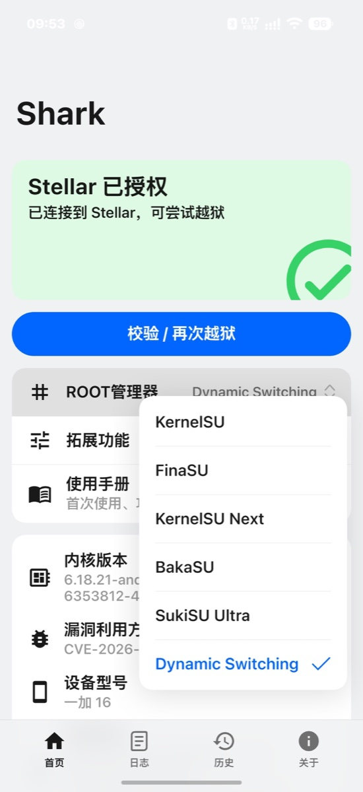
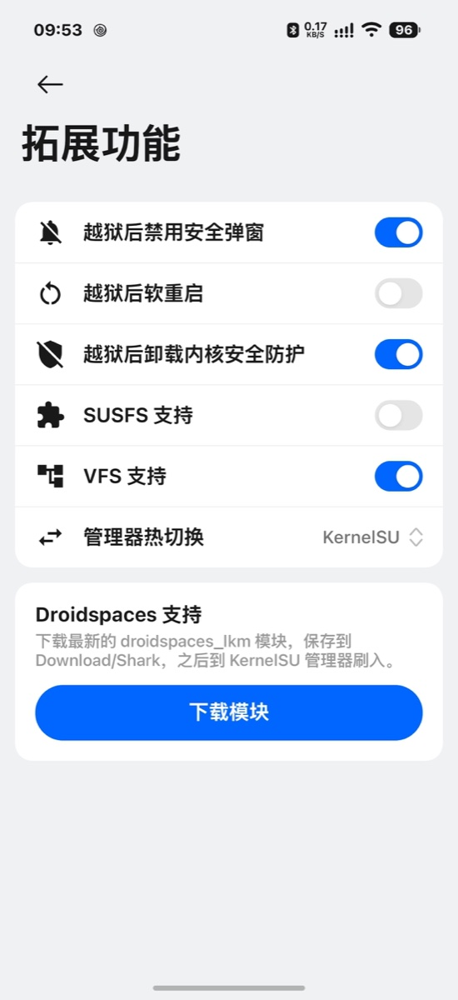

<h1 align="center"> Shark</h1>

<p align="center"><b>多机型 Android 一键临时 Root 与管理器切换工具</b></p>

<p align="center">
  <a href="https://github.com/Yunnijian/Shark/releases/tag/v2.0"></a>
  <a href="LICENSE"></a>
  
  
  
  
  <a href="https://gitee.com/puci1/Shark/releases/tag/v2.0"></a>
</p>

Shark 支持 OnePlus、OPPO、Realme、iQOO 等设备，不用解锁 BL，起手只需要
adb shell；App 通过 Stellar 或 Shizuku 驱动设备端 exploit，拿到临时内核
权限后按所选管理器加载 LKM，最终得到 KernelSU、KernelSU-Next、BakaSU、
SukiSU Ultra 或 FinaSU 的 root 环境。

## 界面

<table align="center">
  <tr>
    <td align="center"><br><sub><b>首页</b></sub></td>
    <td align="center"><br><sub><b>ROOT 管理器</b></sub></td>
    <td align="center"><br><sub><b>拓展功能</b></sub></td>
  </tr>
  <tr>
    <td align="center"><br><sub><b>KernelSU</b></sub></td>
    <td align="center"><br><sub><b>BakaSU</b></sub></td>
    <td align="center"><br><sub><b>SukiSU Ultra</b></sub></td>
  </tr>
</table>

## 支持范围

| 机型 | 系统 | 完整内核版本 |
| --- | --- | --- |
| OnePlus 16（PYB110） | ColorOS 17 | `6.18.21-android17-5-gf957accaf563-ab15926176-4k`<br>`6.18.21-android17-5-g7fcbffcad3e1-ab16353812-4k` |
| OnePlus 15（PLK110） | ColorOS 17 | `6.12.69-android16-6-g242e1a07f878-ab15865446-4k` |
| OnePlus 15T（PLZ110） | ColorOS 17 | `6.12.69-android16-6-g242e1a07f878-ab15865446-4k` |
| OnePlus Ace7 Pro（PMS110） | ColorOS 17 | `6.12.69-android16-6-g242e1a07f878-ab15865446-4k` |
| OnePlus Ace7（PYF110） | ColorOS 17 | `6.12.69-android16-6-g242e1a07f878-ab15865446-4k` |
| OnePlus Ace6T（PLR110） | ColorOS 17 | `6.12.69-android16-6-g242e1a07f878-ab15865446-4k` |
| OnePlus Pad3 Pro（OPD2513） | ColorOS 17 | `6.12.69-android16-6-g242e1a07f878-ab15865446-4k` |
| OPPO Find X9 Ultra（PMA110） | ColorOS 17 | `6.12.69-android16-6-g242e1a07f878-ab15865446-4k` |
| OPPO Pad Mini（OPD2512） | ColorOS 17 | `6.12.69-android16-6-g242e1a07f878-ab15865446-4k` |
| OPPO Pad 5 Pro（OPD2511） | ColorOS 17 | `6.12.69-android16-6-g242e1a07f878-ab15865446-4k` |
| Realme GT8 Pro（RMX5200） | ColorOS 17 | `6.12.69-android16-6-g242e1a07f878-ab15865446-4k` |
| iQOO 15（V2505A） | OriginOS 6 | `6.12.23-android16-5-g41f4cb1fa7c7-abogki465038634-4k` |

## 支持的管理器

KernelSU、KernelSU-Next、BakaSU、SukiSU Ultra、FinaSU 五家。

管理器 APK 不随 Shark 分发，普通模式会直接使用已安装管理器 APK 里的
`ksud`，所以**用哪家就先装哪家**。

## 能做什么

- **一键临时 Root**：打开 App 后不需要手动选漏洞，它会根据 `uname -r`
  自动匹配 6.18 / 6.12 / V2505A 三条链。点一次「一键越狱」即可完成提权、
  `ksud late-load`、模块安装和管理器拉起；临时 Root 在重启后消失，下次
  开机重新执行即可。
- **五家管理器可选**：ROOT 管理器下拉直接选择 KernelSU、KernelSU-Next、
  BakaSU、SukiSU Ultra 或 FinaSU。App 不绑定某一家；管理器 APK 需要自己
  安装，普通模式会直接使用该 APK 里的 ksud 和 LKM。
- **管理器热切换**：支持 6.18 和 6.12。首次干净开机选择 `Dynamic Switching` 加载
  通用 KSU LKM（初始为 KernelSU），之后在拓展功能的「管理器热切换」里
  选目标管理器即可。切换会同步版本号、feature、私有 ioctl 和 primary
  manager，并自动重开目标管理器，不需要重启或重新越狱。
- **拓展功能**：6.18 可加载 VFS provider；6.12 / V2505A 可加载 SUSFS；
  另有反 root 弹窗抑制、越狱后软重启、卸载内核安全防护等开关。按需开启，
  单项失败不会影响已经完成的 root。
- **日志与历史**：运行时日志实时滚动；每次越狱会保存一份完整日志到历史页，
  可查看、删除，左滑可导出分享，方便排查失败或留档。
- **在线更新**：启动时检查 Gitee Releases，失败再回退 GitHub；发现新版本后
  应用内下载，校验 SHA-256 和 APK 签名后再交给系统安装器。
- **Droidspaces 支持**：6.18 下可一键获取最新的 `droidspaces_lkm` 模块，
  保存到 `Download/Shark/`，之后到 KernelSU 管理器里刷入；App 不内置该模块。

## 两种 root 方式

### 普通模式

在 ROOT 管理器里选一家，App 用这家管理器 APK 自带的 `ksud` 加载它自己的
LKM。这就是该管理器原生的 root 环境。

普通模式下换管理器还是需要重启。

### 拓展模式

在 ROOT 管理器里选 `Dynamic Switching`。App 会用内置的
`libksud_universal.so` 加载通用 KSU LKM，初始管理器是 KernelSU。

加载完成后，拓展功能里会出现「管理器热切换」：点开下拉选目标管理器即可，
选中就切换，App 会自动重开目标管理器。切换只改内核里的 manager profile，
不卸载模块、不重启。

通用 KO 和 stock KSU 同名同 hook，所以第一次必须在没有 KSU 的干净开机
状态下加载；已经加载了 `kernelsu` 时不能热替换。

## 使用

1. 安装要用的管理器 APK。想用 Dynamic Switching 的话，建议五家都装上。
2. 启动 Stellar 或 Shizuku，授权 Shark。
3. 在 ROOT 管理器下拉里选普通管理器或 `Dynamic Switching`。
4. 按需打开拓展功能。
5. 点「一键越狱」，等日志出现 `DONE`。
6. 普通模式打开管理器授权 root；Dynamic Switching 在拓展功能里选目标
   管理器，App 会自动切换并打开它。

## 项目框架

Shark 由 Android App、设备端 exploit runner 和可选的内核模块组成。

```text
Shark/
├── app/                         Android App（Gradle 工程）
│   ├── app/src/main/java/com/pyb110/onekey/
│   │   ├── MainActivity.kt      四个 tab、流程控制、管理器与拓展状态
│   │   ├── UpdateChecker.kt     Gitee / GitHub 更新检查
│   │   ├── HistoryStore.kt      日志落盘、历史记录
│   │   └── DroidspacesModule.kt Droidspaces 模块下载
│   ├── app/src/main/jniLibs/arm64-v8a/
│   │   ├── libt98260.so         6.18 runner
│   │   ├── libt61269.so         6.12 runner
│   │   ├── libv2505a.so         V2505A runner
│   │   ├── libksud_universal.so 双 KMI 通用 loader
│   │   ├── libsusfs_guard_lkm.so
│   │   ├── libsusfs_guard_lkm_612.so
│   │   └── libhybridmount.so
│   ├── app/src/main/assets/     manual.md、licenses、赞赏码
│   └── gradle/、keystore/
├── exploit/
│   ├── rust-t98260/             6.18 Rust runner
│   ├── rust-t61269/             6.12 / V2505A Rust runner
│   └── src/                     C plant（98260 核心）
├── lkm/
│   ├── susfs4ksu-lkm/           SUSFS guard 源码
│   ├── hybridmount/             VFS provider 源码
│   └── susfs-tools/             SUSFS 规则工具
├── docs/screenshots/            README 截图
├── ports/v2505a/                V2505A 说明与验证记录
├── third_party/                 第三方许可与材料
├── NOTICE / LICENSE
└── README.md
```

**模块分工**

- `app/`：Kotlin/Compose 界面、Shizuku/Stellar 调用、漏洞链选择、
  拓展开关、日志与在线更新。
- `exploit/`：Rust 单入口 runner 和 C plant，负责提权、fake cred、
  `ksud late-load` 与收尾。
- `lkm/`：SUSFS guard 和 Hybrid Mount VFS provider 的源码与构建脚本。
- `ports/v2505a/`：V2505A 分支的说明、常量和验证记录。
- `third_party/`：第三方许可全文与参考材料。

**技术栈**

- App：Kotlin、Jetpack Compose、COUI、Shizuku / Stellar API。
- 设备端：Rust + C，Android NDK arm64。
- 内核侧：C / GPL-2.0 LKM；通用 KSU KO 在独立项目
  [KSU-Universal](https://github.com/Yunnijian/KSU-Universal)。
- 构建：Gradle Kotlin DSL、Cargo、Android SDK/NDK、Docker DDK。

## 自己编译

App：

```bash
cd app
./gradlew :app:assembleRelease
```

设备端 runner：

```bash
cd exploit/rust-t98260
cargo build --release --target aarch64-linux-android

cd ../rust-t61269
cargo build --release --target aarch64-linux-android
cargo build --release --target aarch64-linux-android --features v2505a
```

通用 KO 和双 KMI loader 在
[KSU-Universal](https://github.com/Yunnijian/KSU-Universal) 里构建，
Shark 只内置编译好的 `libksud_universal.so`。

## 注意事项

- Dynamic Switching 第一次要干净开机；之后切换管理器不用重启。
- 普通模式必须先装对应管理器 APK，ksud 不从 Shark 内置。
- KPM 暂未启用。
- CVE-2026-98260 是竞态 UAF，任何一次运行都可能导致内核 panic 或重启。
- 只用于自己的设备，风险自负。

## 来源与许可

- Shark 自研代码采用 GPL-3.0，见 `LICENSE`；第三方组件见 `NOTICE`。
- 通用 KSU LKM 基于 SukiSU Ultra，GPL-3.0。
- SUSFS guard 和 Hybrid Mount 为 GPL-2.0。
- CVE-2026-98260 设计参考 AzirX1337 的公开移植（MIT）。
- UI 使用 COUI（Apache-2.0），远程执行使用 Shizuku API（Apache-2.0）。

## 发布

- GitHub：https://github.com/Yunnijian/Shark/releases/tag/v2.0
- Gitee：https://gitee.com/puci1/Shark/releases/tag/v2.0
- App：v2.0（90）
- APK SHA-256：`29dabba7fe144593a057715b30ccf0f1aaf5295b12d2883381f62fa6b10d3e94`

通用内核发布：

- https://github.com/Yunnijian/KSU-Universal/releases/tag/v1.1.0
- `ksu_universal-android16-6.12.ko`
- `ksu_universal-android17-6.18.ko`
- `ksud_universal`
