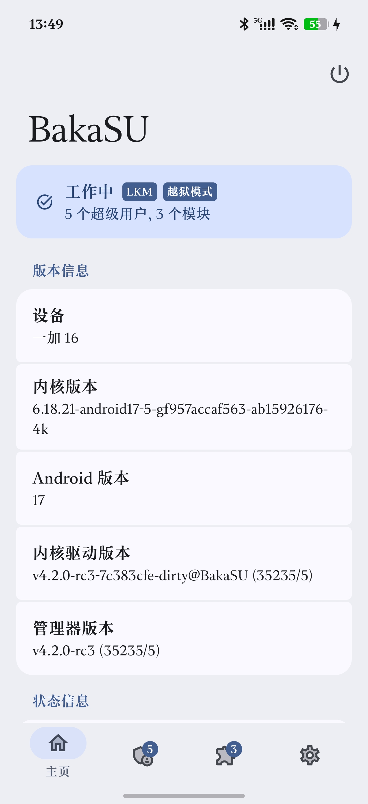
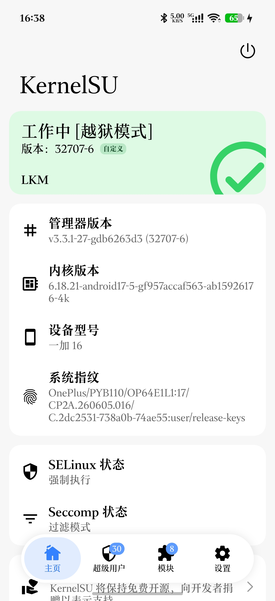
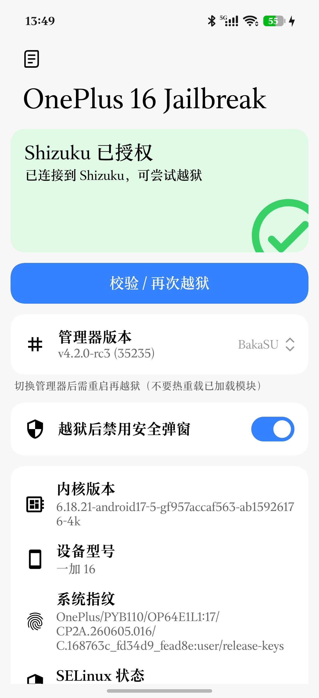
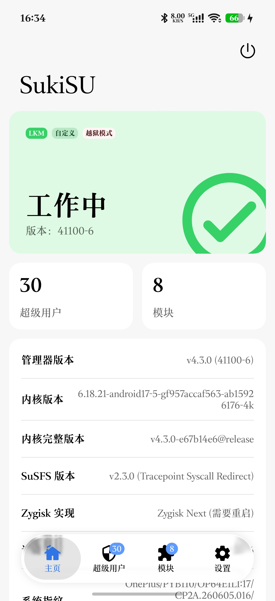
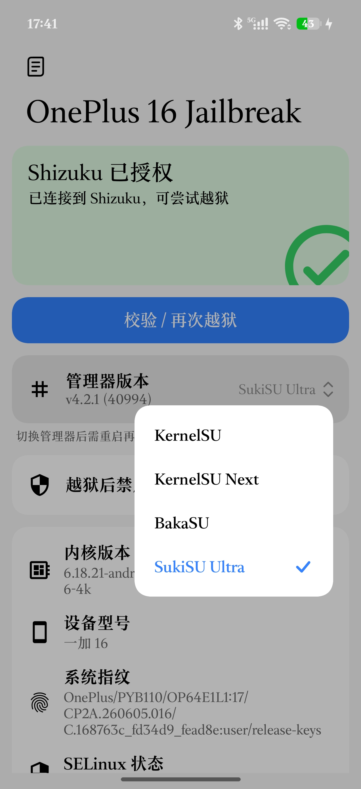

# OnePlus 16 Jailbreak

在 **OnePlus 16（PYB110，SM8950，Android 17 / ColorOS，内核 `6.18.21-android17-5-gf957accaf563-ab15926176-4k`）** 上，通过 **CVE-2026-64560** 提权并加载 **内核态 root（KernelSU / KernelSU Next / BakaSU）** 的一键工具与源码。

设备未解锁 BL，起手只有 adb shell（uid 2000）。工具通过 Shizuku 以 shell 身份驱动设备端 exploit，最终 `finit_module` 加载按本机 GKI 6.18.21 自编的 LKM。

> 仅用于自有设备的系统研究。存在竞态与重启风险，详见「风险」一节。

## 当前状态

- **KernelSU（官方 v3.3.1）**：真机跑通，模块 Live、`su` uid 0、管理器加冕、Enforcing 下可用。
- **BakaSU（原 ReSukiSU）**：LKM/ksud/管理器均对齐官方 CI `v4.2.0-rc3 (35235)`，真机加载成功。
- **KernelSU Next**：LKM 已按同版本 GKI 编译并在 App 中可选，尚未做实机加载验证。
- **SukiSU Ultra**：LKM 按 6.18.21 自编（376,136 B）、管理器 v4.2.1 (40994)，真机加载成功：工作中 [LKM] [自定义] [越狱模式]，模块版本 41027-5，钩子类型 Tracepoint Syscall Redirect。
- App 支持四种 root 管理器下拉选择；release 签名 APK 已构建。
- **双漏洞可选**：默认 `CVE-2026-64560`（逐字段零写 cred），新增 `CVE-2026-98260`（假 cred 指针写 + ksud late-load）。下拉选择后点击“一键越狱”即走对应链路；98260 建议在干净开机后使用。

## 截图

<table align="center">
  <tr>
    <td align="center"><br><sub><b>1 · BakaSU 管理器</b></sub></td>
    <td align="center"><br><sub><b>2 · KernelSU 管理器</b></sub></td>
    <td align="center"><br><sub><b>3 · App 首页</b></sub></td>
    <td align="center"><br><sub><b>4 · SukiSU Ultra</b></sub></td>
    <td align="center"><br><sub><b>5 · 管理器下拉</b></sub></td>
  </tr>
</table>

## 工作原理

```
┌──────────────────────────────┐
│ App (Kotlin/Compose/Miuix)   │
│  - 管理器下拉 / 反 root 开关 │
│  - 日志二级页                │
└──────────────┬───────────────┘
               │ Shizuku (uid 2000)
               ▼
┌──────────────────────────────┐
│ /data/local/tmp/pyb110-<id>  │
│  run.sh 六步：               │
│  1 抓 KASLR slide            │
│  2 解 slide                  │
│  3 按 slide 打补丁生成 ko    │
│  4 selinux_state-7 零写      │
│  5 perf 泄漏 cred + 两阶段写 │
│  6 反 root 守卫 + ksud 安装  │
└──────────────┬───────────────┘
               │ finit_module
               ▼
┌──────────────────────────────┐
│ 内核：kernelsu.ko (LKM)      │
│  - su / 管理器加冕           │
│  - 模块参数 allow_shell=1    │
└──────────────────────────────┘
```

关键点：

- **KASLR slide**：读取 `sched_blocked_reason` tracepoint 的 `%pS` 文本锚点和 per-CPU raw 指针，2MB 对齐投票。
- **关闭 SELinux**：对 `selinux_state - 7` 做 8 字节零写，只覆盖 `enforcing`，保留 `initialized`（避免二次竞态与 `load_policy` 崩溃）。
- **cred 泄漏**：`capset(0)` 触发 `kmem_cache_alloc`，用 perf tracepoint raw 直接拿到新 `cred` 的内核地址。
- **两阶段写**：phase1 清 `cred+0x48`（cap_bset）；phase2 把 `cred+0x40`（cap_effective）写成地址自身，利用 bit7/bit16 获得 `CAP_SETUID`/`CAP_SYS_MODULE`。选位需跨 CPU。
- **加载**：`setfsgid/setfsuid/setresuid(0)` 后 `finit_module(..., "allow_shell=1")`。
- **反 root 守卫**：ColorOS 的 `com.oplus.exsystemservice` 会在检测到提权后弹窗并在 15 秒后 `reboot("Malicious app try to root devices")`。可选开关开启时，流程会在拿到 su 后禁用该包并 kill 进程，**5 秒后自动恢复**（禁用过久会导致系统截图不可用）。
- **管理器加冕**：`chmod 644 /data/system/packages.list` 后原子移出/移回触发 fsnotify。

## 目录结构

```
OnePlus16-Jailbreak/
├── app/                         Android App（Gradle 工程根）
│   ├── app/                     :app 模块（Kotlin/Compose/Miuix/Shizuku）
│   │   ├── src/main/java/...    MainActivity
│   │   ├── src/main/assets/pyb110/  内置 exploit 二进制（约 11 MB）
│   │   ├── src/main/res/        自绘图标与资源
│   │   ├── build.gradle.kts     签名配置 + R8
│   │   └── proguard-rules.pro
│   ├── gradlew / gradle/
│   ├── keystore.properties.example
│   └── settings.gradle.kts
├── exploit/                     提权工具源码
│   ├── src/t64560_w2.c          两阶段 cred 写
│   ├── src/prep_solve.c         设备端 slide 求解
│   └── src/prep_patch.c         ko 符号补丁（UNDEF → link+slide）
├── remote/                      远端素材源
│   ├── scripts/run.sh           64560 六步主流程（运行时下载）
│   └── assets/pyb110/run98260.sh 98260 主流程（brm_plant -> rootd -> late-load）
│   ├── scripts/take_slide.sh    抓 slide
│   └── syms-6.18.21.txt         该内核的符号表
├── assets/                      签名清单 manifest.json / manifest.sig
├── tools/                       发布工具（managers.json + publish_assets.py）
├── lkm/                         LKM 构建脚本
│   ├── build-kernelsu.sh        官方 KernelSU
│   ├── build-next.sh            KernelSU Next
│   ├── build-bakasu.sh          BakaSU（原 ReSukiSU）
│   └── README.md
├── third_party/                 上游工具与许可（CVE 公开仓库）
├── NOTICE                       第三方来源与许可
└── LICENSE                      MIT（本项目自研代码）
```

> 设备端还使用公开仓库提供的 `t64560_v36`、`t64560_loader2`、`forker` 二进制（Apache-2.0），以及 CVE-2026-98260 PYB110 移植的 `brm_plant`、`pc98260_su`（MIT，官方 release `v1.0.0-pyb110-6.18.21`），全部打包在 `app/app/src/main/assets/pyb110/` 内，来源见 `NOTICE`。

## 构建

### App

环境：JDK 21、Android SDK 37、Gradle wrapper（9.7.1）、AGP 9.4.1、Kotlin 2.4.20、Compose BOM 2026.09.00、Miuix 0.9.4。

```bash
cd app
cp keystore.properties.example keystore.properties   # 填入自己的签名信息
# local.properties 里写 sdk.dir=/path/to/android-sdk
./gradlew :app:assembleDebug
./gradlew :app:assembleRelease   # R8 + 资源压缩，约 7 MB（只内置 exploit 工具）
```

`keystore.properties`、`keystore/`、`*.jks`、`local.properties` 已被 `.gitignore` 排除。生成 release 密钥示例：

```bash
keytool -genkeypair -v -keystore keystore/release.jks -alias oneplus16 \
  -keyalg RSA -keysize 4096 -validity 10000 -storetype PKCS12
```

### 远端素材与签名清单

APK 只内置 exploit 二进制（`prep_*`、`t64560_*`、`forker`、`brm_plant`、`pc98260_su`、`run98260.sh`，约 13.4 MB），**按所选漏洞只部署其中一组**（64560 不推 98260 的，反之亦然；98260 也不下载 `run.sh`）。四个管理器的 ko/ksud、`syms.txt`、`run.sh`、`take_slide.sh` 都在运行时下载：

1. 取 `https://raw.githubusercontent.com/Yunnijian/OnePlus16-Jailbreak/refs/heads/main/assets/manifest.json` 与同名 `.sig`；
2. 用 App 内置的 ECDSA P-256 公钥验签（私钥 `keystore/update-signing-key.pem` 永不入库）；
3. 按清单里的 `kernel` 与首页所选管理器挑条目，逐个校验 `size` + `sha256`，`.ko` 还要含 `vermagic=<kernel>` 才接受；
4. 文件按 sha256 缓存在 App 私有目录，拉清单失败时用 last-good 缓存；部署仍走原来的 Shizuku `cat >` 流。

更新一轮素材：

```bash
# 1) 准备 staging（文件名即部署名，syms 用 syms-6.18.21.txt）
# 2) 改 tools/managers.json 里的 label/version
python3 tools/publish_assets.py --src <staging> --out assets \
  --key app/keystore/update-signing-key.pem --upload
# 3) 提交清单，App 下次运行即生效（无需重装）
git add assets/manifest.json assets/manifest.sig
```

`--upload` 会把产物传到一个滚动 Release（默认 tag `assets-latest`，同名资产 `--clobber` 覆盖），清单里的 URL 指向那里。测试时可加 `--base-url http://127.0.0.1:8765` 配合 `adb reverse` 做本地联调（网络安全配置只对回环放行明文）。

### LKM

LKM 必须按设备内核 **6.18.21** 与其符号表自编，不能只改 vermagic 跨版本复用。

环境：GKI `android17-6.18-2026-06_r9` 源 + KDIR（`gki_defconfig`、`modules_prepare`、`security/selinux/built-in.a`）+ DDK 镜像 `ghcr.io/ylarod/ddk-min:android17-6.18-20260828`（clang r584948c）。

```bash
# KernelSU（官方）
bash lkm/build-kernelsu.sh        # 在容器内运行

# KernelSU Next
bash lkm/build-next.sh

# BakaSU（原 ReSukiSU，需 tracepoint hook + 多管理器）
bash lkm/build-bakasu.sh

# SukiSU Ultra
bash lkm/build-sukisu.sh
```

四个产物都需在设备端按当次 boot 的 KASLR slide 由 `prep_patch` 重新写符号。管理器与 ksud 建议直接用官方 release / CI 产物（BakaSU 的 `Manager-release` 与 `ksud`），不要在本地重复编译。

### 设备端工具

`prep_solve.c` / `prep_patch.c` / `t64560_w2.c` 用 NDK 静态编译为 aarch64：

```bash
CC=$NDK/toolchains/llvm/prebuilt/<host>/bin/aarch64-linux-android26-clang
$CC -O2 -static -o prep_solve exploit/src/prep_solve.c
$CC -O2 -static -o prep_patch exploit/src/prep_patch.c
$CC -O2 -static -o t64560_w2 exploit/src/t64560_w2.c
```

`run.sh` 从 `/data/local/tmp/pyb110-<boot_id>-<epoch>/` 运行，按 `PYB110_MANAGER`（`kernelsu` / `next` / `bakasu` / `sukisu`）与 `PYB110_DISABLE_ANTIROOT`（`1` / `0`）选择行为。

## 使用

1. 用无线调试启动 Shizuku，并授权本 App。
2. 首页选择 root 管理器（KernelSU / KernelSU Next / BakaSU / SukiSU Ultra）。切换管理器后需重启再越狱（已加载模块不能热替换）。
3. 可选开启「越狱后禁用安全弹窗」：禁用 5 秒后自动恢复；如截图等系统功能异常，软重启（重启 zygote/SystemUI）。
4. 可选开启「越狱后软重启」：越狱流程跑完且模块确认加载后，以 `su` 执行 `setprop ctl.restart zygote`，等同软重启；失败不会影响已完成的越狱。
5. 点击「一键越狱」，等待日志出现 `DONE`。首次运行会走竞态，可能概率性重启。
6. 越狱成功后用对应管理器授权 root。

## 已知限制

- **换管理器必须重启**：`rmmod kernelsu` 会被模块自身的 kprobe/tracepoint 引用计数挡住（EAGAIN）；强制卸载会撞上 `file_wrapper` 未反注册导致 kpanic。
- **KernelSU Next** 尚未做实机加载验证。
- App 依赖 Shizuku 服务；重启后需重新启动 Shizuku。
- 反 root 开关关闭时，加载后可能触发 ColorOS 安全弹窗并在 15 秒后重启。

## 风险

- CVE-2026-64560 是竞态 UAF，任何一次运行都可能导致内核 panic / 重启。
- 本工具仅用于**自有设备**的系统研究与 root 管理；请勿用于未授权设备。
- 使用 root 与内核模块存在数据损坏、保修失效等风险，风险自负。

## 来源与许可

- 提权原语与 `t64560_v36` / `t64560_loader2` / `forker`、部分上游脚本：  
  [Feng1586/CVE-2026-64560-public](https://github.com/Feng1586/CVE-2026-64560-public)（Apache-2.0）。
- 官方 KernelSU：[tiann/KernelSU](https://github.com/tiann/KernelSU)（GPL-2.0）。
- KernelSU Next：[rifsxd/KernelSU-Next](https://github.com/rifsxd/KernelSU-Next)（GPL-2.0）。
- BakaSU（原 ReSukiSU）：[Baka-SU/BakaSU](https://github.com/Baka-SU/BakaSU)（GPL-2.0）。
- SukiSU Ultra：[SukiSU-Ultra/SukiSU-Ultra](https://github.com/SukiSU-Ultra/SukiSU-Ultra)（GPL-3.0）。
- UI：[Miuix](https://github.com/miuix-kotlin-multiplatform/miuix)（Apache-2.0）；远程执行：[Shizuku API](https://github.com/RikkaApps/Shizuku-API)（Apache-2.0）。
- 本项目自研代码（App、exploit 封装、构建脚本）采用 MIT，详见 `LICENSE`；第三方二进制与源码遵循各自许可，详见 `NOTICE`。

## 校验和

- release APK：`PYB110-OneClick-release.apk` / 22,240,543 B / md5 `3528f2e036441fbe6b33c5a850dcf11d`（对应交付目录，不在本仓库内）。
- 官方 KernelSU LKM（6.18.21）：348,848 B；Next：350,000 B；BakaSU：385,440 B（strip 后）。
